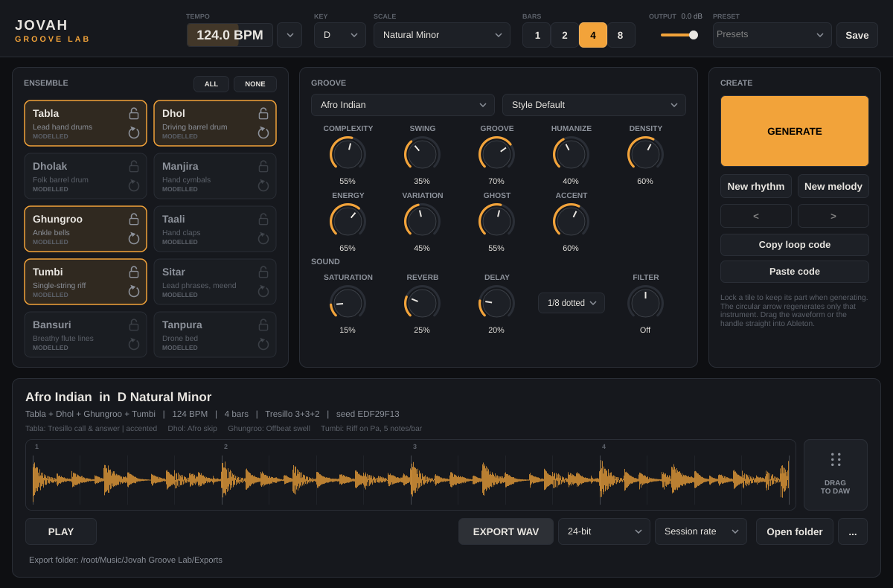

# Jovah Groove Lab — Indian loop generator (VST3 / AU / Standalone)

Jovah Groove Lab generates **original Indian instrumental loops** for electronic music
(Afro house, melodic/progressive house, underground, techno). Pick instruments, key, scale, tempo
and a groove personality, press **GENERATE**, preview it in sync with your DAW, then
**drag the WAV straight into Ableton Live** or export it.

Everything is generated locally from deterministic music rules: no internet, no AI service and no GPU.
No third-party recordings are bundled. Every sound is synthesized by the plugin's own instrument
models, or comes from samples **you** install (see [Recorded samples](#recorded-samples)).



---

## Features

| Area | What it does |
|---|---|
| **Instruments** | Tabla, Dhol, Dholak, Manjira, Ghungroo, Taali (claps), Tumbi, Sitar, Bansuri, Tanpura. Each has its own articulations, such as tabla bols Dha/Dhin/Ge/Ka/Na/Tin/Tun/Te/Re/Ghe (gumki glide), dhol dagga/tilli/edge/both, and manjira open/closed. |
| **Personalities** | Afro Indian, Tribal Ritual, Indian Underground, Psychedelic India, Melodic Indian, Peak-Time Percussion, Minimal Hypnosis, Folk Electronica, Custom. Each changes the pattern vocabulary, framework, microtiming pocket, fills, polymeter, repetition and melodic behaviour. |
| **Rhythmic frameworks** | Keherwa (8), Dadra (6, triplet grid), Teentaal (16), Rupak (7 = 3+2+2), Club 4/4, Tresillo 3+3+2, all adapted to a 4/4 club grid. |
| **Groove engine** | Complexity, Swing (50–75 %), Groove (personality microtiming), Humanize (per-hit plus slow player drift), Density, Energy, Variation, Ghost level, Accent strength. |
| **Phrasing** | Motif-based bars (A A′ A F, with 8-bar forms and contrasting B halves), ghost notes that anticipate strong hits, rolls, phrase-end fills including **tihai** cadences, and polymetric textures (3/5/7 over 16). |
| **Melody** | 9 scales/modes plus 9 **raga-inspired** profiles (Bhairav, Bhairavi, Yaman, Kafi, Bhupali, Malkauns, Desh, Todi, Charukeshi) with aroha/avaroha direction rules and vadi/samvadi emphasis. Includes call and response (sitar calls, bansuri answers), riffs, meend glides, murki, kan and a tanpura drone. |
| **Sound** | Saturation (2× oversampled), FDN reverb, tempo-synced ping-pong delay, DJ low/high-pass filter, and master output level. Tails wrap seamlessly around the loop. |
| **Loop control** | 70–160 BPM with tempo presets and optional host-tempo follow; 1/2/4/8 bars; all 12 keys. Lengths are exact to the sample. |
| **Workflow** | Per-instrument **lock** and **regenerate**, *New rhythm* / *New melody*, back/forward history, factory presets, favourites, and **loop codes** that reproduce any loop exactly. |
| **Export** | WAV 24-bit (default), 16-bit (TPDF dither) or 32-bit float, at the session rate or 44.1/48/88.2/96 kHz (re-rendered, not resampled). Files carry ACID tempo/beat metadata. **Drag-and-drop** from the waveform or the DRAG handle. |

---

## Building

Requirements: CMake ≥ 3.22, a C++17 compiler, and Git (JUCE 8.0.9 is fetched automatically).

### macOS (VST3 + AU + Standalone)

```bash
cmake -S . -B build -DCMAKE_BUILD_TYPE=Release -DCMAKE_OSX_ARCHITECTURES="arm64;x86_64"
cmake --build build --config Release -j 8
```

Artefacts are in `build/JovahGrooveLab_artefacts/Release/`:

* `VST3/Jovah Groove Lab.vst3` → copy to `~/Library/Audio/Plug-Ins/VST3/`
* `AU/Jovah Groove Lab.component` → copy to `~/Library/Audio/Plug-Ins/Components/`
* `Standalone/Jovah Groove Lab.app`

To install automatically after building, add `-DJGL_COPY_PLUGIN_AFTER_BUILD=ON`. Validate the AU with
`auval -v aumu JgLb Jova`.

### Linux (VST3 + Standalone)

```bash
sudo apt install libasound2-dev libx11-dev libxrandr-dev libxinerama-dev libxcursor-dev \
                 libxcomposite-dev libxext-dev libfreetype-dev libfontconfig1-dev libgl1-mesa-dev
cmake -S . -B build -G Ninja -DCMAKE_BUILD_TYPE=Release
cmake --build build
```

### Windows

```bash
cmake -S . -B build
cmake --build build --config Release
```

Options: `-DJGL_JUCE_DIR=/path/to/JUCE` uses a local JUCE checkout, `-DJGL_BUILD_TESTS=OFF` and
`-DJGL_BUILD_TOOLS=OFF` skip the extras.

### Tests

```bash
cmake --build build --target JGLTests
./build/JGLTests_artefacts/Release/JGLTests
```

The suite (≈74 000 checks) covers:
* exact loop durations for every bar count at 44.1/48/96 kHz and 70–160 BPM
* swing warp and humanisation bounds
* every melodic note staying in the selected scale, with zero aroha/avaroha violations across all 18 profiles
* unpitched drums rendering bit-identically in every key
* determinism and seed reproducibility
* regenerating one part leaving every other part untouched
* density/energy behaviour, personalities that differ, and phrase fills and repetition
* normalisation and no clipping, a seamless loop seam, silent-ensemble handling, and the recorded-sample override
* WAV round trips in all three formats (length, rate, bit depth, ACID tempo)
* presets
* the lock-free audio hand-off under a two-thread stress test (no leaks), host sync, click-free loop swaps
* plugin state save/restore and the end-to-end processor → audio → export path

CI (`.github/workflows/build.yml`) runs the tests on Linux and macOS. It also runs
[pluginval](https://github.com/Tracktion/pluginval) at strictness 10 on the VST3 and AU, and `auval -strict` on the AU.

### Command-line renderer

`jgl_render` generates loops without a host, which is handy for auditioning and batch creation:

```bash
./build/jgl_render_artefacts/Release/jgl_render --list
./build/jgl_render_artefacts/Release/jgl_render --style 0 --bpm 124 --key D --scale 1 \
    --inst dhol,tabla,tumbi --seed 42 --grid --out afro_124_Dmin.wav
```

`--grid` prints a drum-machine view of every part. `--stems dir` writes one dry WAV per part.

---

## Using it in Ableton Live

1. Build and install as above, then in Live open **Preferences → Plug-Ins**. On macOS enable *Use Audio Units v2* and/or *Use VST3 Plug-In System Folders*, then press **Rescan**.
2. Drag **Jovah Groove Lab** (Instruments → Plug-Ins) onto a **MIDI track**.
3. Choose instruments, key, scale, BPM (or tick **Host tempo** to follow Live) and bars, then press **GENERATE**.
4. Preview it:
   * press **PLAY**, or
   * press play in Live. With **Sync to host transport** on, the preview locks to Live's bar position, or
   * play any MIDI note on the track. Note-on starts the loop from bar 1 and releasing all notes stops it.
5. Shape it with the knobs. Changes re-render in the background in about 0.1–0.7 s while the groove stays the same. **Lock** the parts you love, then press **GENERATE** or a tile's ↻ to replace only the rest.
6. **Drag the waveform** (or the **DRAG TO DAW** handle) onto an audio track, or press **EXPORT WAV**. Files go to `~/Music/Jovah Groove Lab/Exports/`, named like `IndianGroove_AfroIndian_124BPM_Dmin_4Bars.wav` (percussion-only loops omit the key).
7. In Live the clip is exactly N bars long. With auto-warp on it is detected at the right tempo, and the file also carries an ACID tempo chunk.

### Drag-and-drop: implementation and status

Dragging uses JUCE's `DragAndDropContainer::performExternalDragDropOfFiles`. On macOS this starts a
native `NSDraggingSession` from the plugin's own view with a file-URL pasteboard item, and on Windows
an OLE `DoDragDrop`. This is the same mechanism other JUCE-based plugins use to drag audio into Live.
The WAV is written to the exports folder *before* the drag starts. Dragging the same loop again reuses
that file, and nothing is ever written to a temporary folder Live might later lose.

**Verification status:** pluginval (strictness 10) and `auval -strict` validate the VST3 and AU in CI.
The drag gesture itself was exercised on Linux/X11 in development. **It has not yet been tested by hand
inside Ableton Live on a Mac**, because the development environment had no macOS host or Ableton
licence. If a host ever refuses the drag, the status line shows the full path of the already-saved
WAV, and **EXPORT WAV** plus **Open folder** always work.

---

## Recorded samples

The built-in sounds are **physically informed synthesis models**: modal membranes and plates with
contact noise for the drums, and a band-limited additive engine with a moving *jawari* formant,
sympathetic strings, vibrato and meend for the strings and winds. They are entirely original, so
there is no licensing risk, and they respond to velocity with real timbre changes. They are still models,
not recordings. For the most realistic results, add your own **licensed** recordings. The plugin
uses them automatically, with velocity layers and round-robin takes.

```
~/Music/Jovah Groove Lab/Samples/
  tabla/Na/na_v1_rr1.wav  na_v1_rr2.wav  na_v2_rr1.wav ...   (_v1.._v4 = velocity layers, soft→hard)
  tabla/Ge/...  tabla/Ka/...  tabla/Tin/...  tabla/Te/...      (Dha/Dhin are built from Na/Tin + Ge if absent)
  dhol/Dagga/...  dhol/Tilli/...  dhol/DaggaMuted/...  dhol/TilliEdge/...  dhol/Both/...
  dholak/{Ge,GeSlide,Na,Ta,Chat}/   manjira/{Open,Closed}/   ghungroo/{Shake,LongShake,Stamp}/   taali/{Clap,Group}/
  sitar/notes/sitar_C3.wav  sitar_G3.wav ...                   (root from the note name, C4 = MIDI 60, or a MIDI number)
  tumbi/notes/  bansuri/notes/  tanpura/notes/
```

WAV, AIFF and FLAC are supported. Files are downmixed to mono and trimmed to 12 s. Use **… → Rescan
samples** after adding files. Tiles show **SAMPLES** or **MODELLED** so you always know which you hear.
**Never use material cut from commercial songs.** Use recordings you made or properly licensed,
royalty-free packs.

---

## Architecture

```
Source/
  Core/        music types, deterministic RNG, instrument registry, scales & raga profiles,
               personalities & taal frameworks, settings, parameter IDs
  Generation/  PatternLibrary (hand-designed groove vocabulary), RhythmGenerator, MelodyGenerator,
               Arranger (seeded per-part composition), GrooveEngine (swing/microtiming/humanize)
  DSP/         Voices (instrument models), SampleLibrary (recorded overrides), Effects, LoopRenderer
  Engine/      GenerationService (background worker), LoopPlayer (real-time playback), LoopResult
  IO/          WavExporter, PresetManager, AppPaths
  Plugin/      Parameters, PluginProcessor, PluginEditor
  UI/          Theme (look & feel, knobs), InstrumentTile, WaveformView (+ drag handle)
Tests/         JUCE UnitTest suite        Tools/  jgl_render CLI
```

**Pipeline.**
1. **Compose** (pure, seeded). `ComposeSettings` and a `SeedSet` give an `Arrangement` of grid events. Each part depends only on its own seed, the settings and the enabled-instrument set, which is what makes lock, regenerate-one-part, new rhythm/new melody and reproducible loop codes exact.
2. **Render** (background thread). The `GrooveEngine` applies swing, microtiming and humanisation. Each hit or note is rendered by a voice model (or a user sample) into a **circular** buffer of exactly the loop length, so tails wrap like a repeating loop. Stateful FX are run to steady state over several passes of the loop, then the result is normalised to −1 dBFS and the output level applied.
3. **Play** (audio thread). Rendered loops reach `LoopPlayer` through a lock-free SPSC FIFO and are retired through a second FIFO to the message thread. The audio thread never allocates, frees, locks or touches files. Swaps crossfade and keep the musical position, and playback can lock to the host's PPQ.

Knob changes are debounced on the message thread. When only render settings change (swing, FX, key,
BPM) the cached composition is reused, so the groove stays identical while the sound updates. A
sample-rate change triggers a re-render, and playback resamples meanwhile.

**Determinism.** All randomness comes from a platform-independent xoshiro256** generator, never
`std::rand` or `std::random` distributions. Knobs compare against fixed per-step random draws, so turning
*Density* up adds notes to the same pattern instead of reshuffling it.

## Known limitations

* The built-in instruments are synthesized models. They are convincing as electronic-music textures, but not indistinguishable from studio recordings. Install recorded samples for maximum realism.
* Raga-inspired profiles are deliberately simplified (note sets, aroha/avaroha, vadi/samvadi, characteristic movements). They are not complete classical raga grammars.
* The tabla's treble drum (dayan) is tuned to the key's Sa, as tabla traditionally is. All other drums are unpitched and ignore the key.
* Loops are 4/4. Odd-meter frameworks (Dadra, Rupak) are folded onto the 4/4 grid as feels and polymeters so they stay DAW-friendly.
* Manual testing inside Ableton Live (loading, drag-and-drop, warping) remains to be done on a Mac. See *Drag-and-drop: implementation and status*.

## Licensing

Jovah Groove Lab's own code and its generated audio are original. JUCE is dual-licensed (AGPLv3 or a
commercial JUCE licence). Closed-source distribution requires an appropriate JUCE licence. The VST3 SDK
is MIT-licensed. No third-party audio recordings are included.
